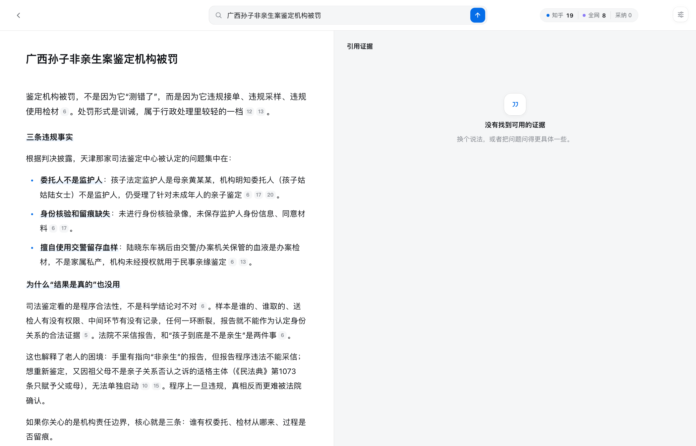

# ZSearch

> **在 DeepSeek Harness 里，把「查一下」变成一次有出处的双源检索。**
>
> 问一个问题，同时检索**知乎**和**全网**；左边是流式 AI 综述，右边是它引用的逐字原文。结论带 `[1]`、`[2]` 角标，点一下回到出处。

**智能搜索插件 · 知乎 + 全网 · 左答右证**

版本 **0.3.0** · Apache-2.0 · 适用于 DSH `>=0.2.2-rc.1 <0.3.0`
GitHub 已公开，npm 包尚未发布（当前请从源码安装）。


---

## 为什么需要它

用 DeepSeek Harness 写代码、做判断、查资料时，最常打断心流的动作是「查一下」：

- 这个新工具/新模型到底靠不靠谱？
- 这个报错有没有人踩过，最后怎么解决的？
- 这件事知乎上有没有**最新讨论**，全网有没有官方说法？
- 这个说法是真是假，原始出处在哪？

以前的做法是：开浏览器 → 搜一遍 → 切到知乎 → 再切回文档 → 自己把结论拼起来。信息是散的，出处也是散的。

**ZSearch 把这次检索留在 DSH 里。** 一次输入，同时拿到「可以读的结论」和「可以核对的原文」。

## 它是什么

一句话：**左边给你答案，右边给你证据。**

- **智能搜索，而不是关键词列表**：先理解问题、扩展检索式，再把候选交给模型归纳成一篇可读的综述。
- **知乎 + 全网双源**：知乎提供真实经验、最新讨论、踩坑、争议和从业者视角；全网提供官方文档、新闻、博客、issue 和价格页。同一个问题，两种信息放在一起看。
- **结论可核对**：回答里的每个角标都能点回对应的逐字原文，不是“模型说”。
- **不离开 DSH**：查完继续写代码、继续对话；选中一段话还能直接划词检索。

### 它不是什么

- 不是通用搜索引擎的替代品：它更适合「需要理解、比较、看社区观点」的问题。
- 不是知乎客户端：不登录知乎账号、不发布内容、不做个人数据面板。
- 不是自动事实核查器：它给你线索和出处，最终判断仍由你来做。

## 你会得到什么

| 你会看到 | 它意味着什么 |
|---|---|
| **左侧流式回答** | 先给判断和结构，再展开细节；支持 Markdown、表格、代码块、引用和链接 |
| **右侧引用卡** | 按「视角」分组，每张卡是 1–2 句逐字原文 + 来源；不是二手转述 |
| **可点击角标** | `[1]`、`[2]` 直接定位到证据卡，回答和原文对得上 |
| **其他参考内容** | 回答引用了、但没被分组的候选，会自动补到右栏底部，避免角标悬空 |
| **划词检索** | 在对话里选中一段文字，点浮层直接带词搜索 |
| **状态恢复** | 切走或刷新后，检索词、回答和卡片还在 |



## 专题：热门插件

ZSearch 不只是一个通用搜索框。首页输入框下方的「热门插件」专题，把 DSH 社区插件整理成一张可浏览的列表：

- **按 GitHub Star 排序的 60 个插件**：卡片展示名称、分类、简介、Star 和月下载量。
- **点开就是评测**：左上角是插件卡（仓库、安装命令、一键安装），左边是 AI 评价，右边是社区评价。
- **右边按视角分组**：例如核心卖点、真实体验、局限与风险、替代方案、安装注意；没有证据的视角不会硬凑。
- **不是通用搜索换个皮**：插件模式会把插件名、仓库、分类和简介作为检索上下文，回答按“值不值得装、优点、局限、替代方案、安装注意”组织，结论仍然带角标。

目录整理于 2026-11-04，是当时快照；安装的是第三方代码，确认前请核对来源。

## 典型场景

| 场景 | 你会问 | ZSearch 给你 |
|---|---|---|
| **技术选型** | 「这个 DSH 插件怎么装？值不值得装？」 | 官方说明 + 知乎真实使用体验 + 踩坑记录 |
| **插件选型** | 「这个插件适合我吗？有没有替代？」 | 插件卡 + AI 评价 + 社区真实反馈 |
| **新工具/新产品** | 「某某模型和某某工具怎么选？」 | 官方参数、社区评价、实际成本与限制 |
| **报错与踩坑** | 「这个错误有没有人遇到过？」 | issue、博客、知乎回答里的解决路径 |
| **热点事件** | 「这件事现在大家怎么看？」 | 全网报道 + 知乎社区的不同立场 |
| **写作与选题** | 「这个题目知乎上讨论过吗？」 | 已有观点、争议点和可引用的原文 |
| **事实核对** | 「这个说法出自哪里？」 | 原始链接和逐字片段，方便你自己判断 |

## 安装

当前 npm 包尚未发布，推荐从源码安装。

### 桌面端

1. 克隆仓库：

   ```sh
   git clone https://github.com/hAcKlyc/dsh-zsearch.git
   ```

2. 打开 **Plugins → Add plugin**，选择 `dsh-zsearch` 目录。
3. 安装后重启 DSH（Host 代码在启动时加载）。

### CLI

```sh
git clone https://github.com/hAcKlyc/dsh-zsearch.git
dsh plugin --profile <profile> add ./dsh-zsearch
```

安装或更新 Host 代码后需要重启 DSH。卸载：

```sh
dsh plugin --profile <profile> remove dsh-zsearch
```

> npm 发布后，可以直接用包名安装：
>
> ```sh
> dsh plugin --profile <profile> add dsh-zsearch
> ```

## 第一次使用

ZSearch 需要三样东西：**知乎 CLI、Access Secret、一个可用的 DSH 模型**。

插件会检测 `zhihu-cli` 和 Access Secret，缺失时显示三步引导：

1. **安装知乎 CLI**：读取官方 manifest、下载 Skill、校验 SHA-256 后安装；
2. **配置 Access Secret**：提交到 Host，经 `auth set --secret-stdin` 写入系统钥匙串；
3. **完成**：`cli.found && auth.configured` 后即可开始检索。

Secret 不会写入仓库、日志或对话记录；钥匙串不可用时回退到宿主 `credentials`，以进程环境变量传给 CLI。

## 环境要求

- **DeepSeek Harness** `>=0.2.2-rc.1 <0.3.0`（桌面端或 `dsh web` 均可）。
- **Node.js** `>=24.9.0`（DSH 自身要求）。
- 本机 **`zhihu-cli`** 与知乎 **Access Secret**。
- DSH 中已配置可用的默认模型：回答、筛选和扩词都通过宿主模型完成。

## 数据与隐私

- 检索通过本机 `zhihu-cli` 的 `search zhihu` / `search global` 完成。
- 回答、筛选和扩词使用 DSH 宿主当前配置的模型；插件本身不保存模型 Key。
- Host 只监听 `127.0.0.1`；无遥测、无外部上报。
- 头像只代理 `zhimg.com` 的 HTTPS 图片，限制 512KB。
- 面板状态存在当前 Web GUI origin 的 `localStorage`（键 `dsh-zsearch:panel.v1`，schema v2），不包含 Access Secret。

## 兼容性与已知限制

- 兼容 DSH `0.2.2-rc.1` 起；已在 `0.2.2-rc.3` 上验证。DSH 升级可能带来接口变化，升级前请查看 DSH 的升级指南。
- 回答基于候选原文生成，右栏展示的是筛选摘句，不保证语义上逐字同源；「其他参考内容」只缓解这一点。
- 回答输入约 1.3 万字符，成本和延迟高于轻量检索。
- 缓存命中时「重新检索」仍可能拿到旧缓存（Client 不发送 `refresh=1`）。
- 同 query 并发不合并；没有分阶段的 token 统计，只有总数与诊断环。
- 回答被 provider 中断或超时时会显示「回答生成中断」，保留已生成部分，不自动续写。
- 检索结果取决于 `zhihu-cli` 当时能返回的内容，不保证实时覆盖每一条新讨论。
- 插件专题目录是 2026-11-04 的快照，Star/下载量不是实时排名；插件评价每次打开都重新生成，不跨刷新保存。
- 安装按钮会把第三方代码装进当前 Profile，确认前请核对来源；安装完成后通常需要重启 DSH。

---

## 它是怎么工作的（技术）

一次典型的冷启动检索：

```text
问题
 ├─ 扩词（模型 ①）→ 多个检索式
 ├─ 本机 zhihu-cli 双源检索 → ≤70 个候选（candidateId）
 ├─ 分组摘引（模型 ②）→ 主题 + 视角分组 + 逐字摘句
 └─ 写回答（模型 ③）→ 流式回答，按候选编号引用
        ↓
   引用核对 → 缺失补卡（模型 ④，按需）→ citations → done
```

- 模型 ②（筛选）和模型 ③（回答）**并行**，回答不用等右栏整理完。
- 插件模式只替换检索上下文和筛选/回答 prompt，仍走同一条扩词 → 检索 → 并行筛选/回答管线。
- 回答按候选编号引用，服务端通过 `citations` 事件映射到显示序号。
- 冷启动通常 3 次模型调用；出现缺失引用时 +1 次补卡。10 分钟缓存命中时只重跑回答。
- Host 通过 SSE 把 `plan`、`card`、`answer`、`topic`、`citations`、`done` 等事件推给页面。
- 不依赖构建步骤、不引入运行时 npm 依赖；使用 Node 内置模块和 DSH 宿主服务。

### Host 接口

| 路由 | 用途 |
|---|---|
| `GET /zsearch/api/plugins/list` | 热门插件目录（按 Star 排序） |
| `GET /zsearch/api/plugins/install/inspect` | 安装前检查插件来源 |
| `POST /zsearch/api/plugins/install` | 经 DSH Plugin Manager 安装 |
| `GET /zsearch/api/stream?q=` | SSE 检索与回答；插件模式追加 `mode=plugin&pluginId=` |
| `GET /zsearch/api/setup/status` | CLI / Secret / Skill 状态 |
| `GET /zsearch/api/setup/install` | 安装知乎 CLI 和 Skill |
| `POST /zsearch/api/setup/secret` | 写入 Access Secret |
| `GET /zsearch/api/diagnostics` | 最近 20 次检索的 finish / usage / 耗时 |
| `GET /zsearch/api/health` | 健康检查 |

## 开发

```sh
npm run verify
```

等价于：

```sh
node --check index.js
node --check client.js
node test/integration.mjs
node test/client-smoke.mjs
node test/client-render.mjs
```

- Host 代码（`index.js`）在 DSH 启动时加载，改完必须重启；只改 `client.js` 刷新页面即可。
- 测试使用假 CLI / 假模型，不消耗真实额度；真实模型质量需要单独评估。
- `GET /zsearch/api/diagnostics` 可查看最近 20 次检索的 finish / usage / 耗时（不包含回答正文）。

### 目录

```text
index.js            Host 半：检索、模型调用、SSE、安装引导、插件目录/安装
client.js           Client 半：面板、结果页、插件专题、Markdown 渲染
cordis.patch.yml    bundle patch
data/plugins.json   热门插件目录快照（60 条，按 Star 排序）
locale/             插件标题、描述、详情页入口
icon.svg            插件图标
docs/DETAIL.md      插件详情页文档
docs/design.md      视觉规范
docs/flow-and-prompts.md  设计与 prompt 变更日志（历史材料，不是现行接口契约）
test/               集成、Client 注册、渲染测试
```

## 许可证

[Apache-2.0](LICENSE)
