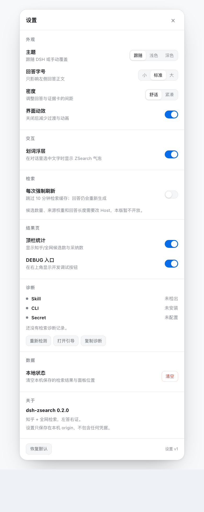
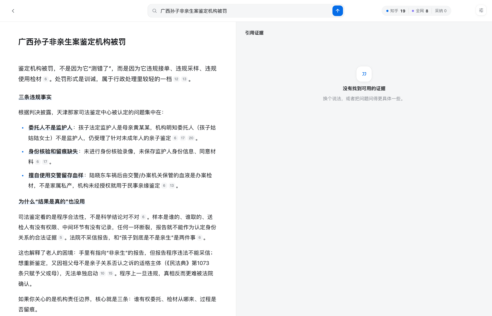
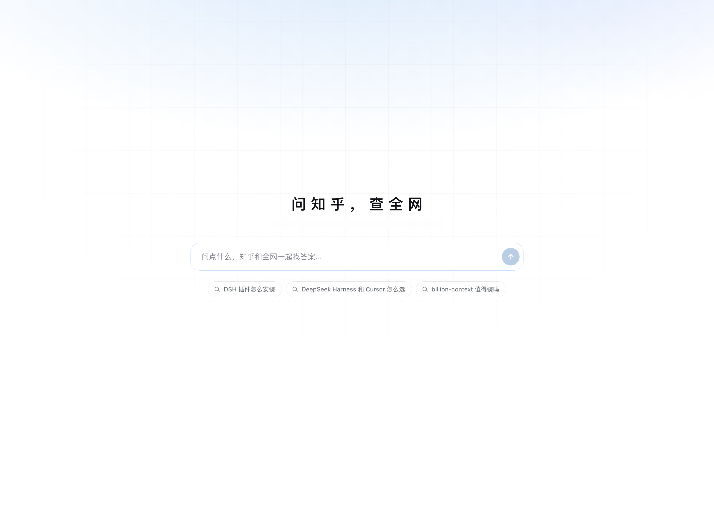

# ZSearch 美学设计规范（design.md）

> 版本：**v0.2.0** · 状态：**现行（视觉规范）** · 更新：2026-11-15
> 适用：`client.js` 0.2.0；视觉规范随插件包一起维护。
>
> 目标：在 DeepSeek Harness 里，ZSearch 看起来像 DSH 的一个原生页面；颜色上一眼能认出是知乎。
> 一句话：**DSH 的骨架，知乎的蓝。**

## 1. 三张参考图的分析

| 来源 | 关键特征 | 取 / 舍 |
|---|---|---|
| 知乎 Web（图 1） | 品牌蓝 `#056DE8`；白卡片放在浅灰底 `#F6F6F6` 上；色块按钮「赞同 991」；信息密度高；热榜里有红色「热」标 | **取**：品牌蓝，以及作者、赞同、评论这些社区信号。**舍**：大面积纯蓝色块、密集的分隔线、门户式排版 |
| DeepSeek 官网（图 2） | 雾面蓝色光晕（多个模糊色团）、淡网格底纹、字距很宽的大标题「探 索 未 至 之 境」、玻璃质感输入框、胶囊切换按钮 | **取**：首页的光晕和网格氛围、留白、宽字距标题、胶囊 chip。**舍**：营销页的大尺寸（插件放在面板里，要克制） |
| DSH 桌面端（图 3） | `neutral-bluish` 冷灰阶；0.5px 发丝描边加极淡阴影（`--dsw-elevation-*`）；主操作按钮是 DeepSeek 蓝圆钮；12–20px 圆角；600 字重小标题；Montserrat 字标 | **取**：整套 token、描边方式、圆钮、字体栈和暗色模式。这是骨架 |

## 2. 设计原则

1. **原生优先**：背景、文字、边框、阴影全部走 `--dsw-alias-*` / `--dsw-elevation-*`。暗色模式（`body[data-ds-dark-theme]`）自动生效，不再写死浅色。
2. **蓝色只用在关键处**：知乎蓝只用于品牌字标、主按钮、引用角标、焦点环、正在生成的指示。其余全是中性灰，蓝色才显得贵。
3. **左答右证，一主一辅**：回答是一篇「文档」，用无卡片的排版，靠字体层级组织；证据是「卡片」，靠描边和阴影浮起来。两栏质感不同，读者一眼分得清。
4. **来源可辨**：知乎卡和全网卡在左上角用来源徽标（「知」字方块、域名首字母方块）区分，不靠整卡染色。
5. **动效有意义**：卡片到达时上浮淡入；回答生成时显示流光进度条；角标点击时对应证据卡出现脉冲描边。所有动效遵守 `prefers-reduced-motion`。

## 3. 色彩

### 品牌色（插件自有，命名 `--zs-*`）

| Token | 浅色 | 暗色 | 用途 |
|---|---|---|---|
| `--zs-brand` | `#056DE8`（知乎现行品牌蓝） | `#4C9BFF` | 主按钮、角标、链接、焦点 |
| `--zs-brand-strong` | `#0459C2` | `#78B3FF` | hover / 按下 |
| `--zs-brand-soft` | `rgba(5,109,232,.08)` | `rgba(76,155,255,.14)` | 角标底、chip hover、提问气泡 |
| `--zs-brand-ring` | `rgba(5,109,232,.22)` | `rgba(76,155,255,.32)` | 焦点环、flash 描边 |
| `--zs-aurora-1` | `#8EC5FF` | `#1E4C8F` | Onboarding 光晕：知乎蓝系 |
| `--zs-aurora-2` | `#B7C8FE`（deepseek-300） | `#2B3A66` | Onboarding 光晕：DeepSeek 紫蓝 |
| `--zs-grad` | `linear-gradient(135deg,#0A84FF,#056DE8 45%,#4176E6)` | 同色相提亮 | 字标 / 主按钮 / 进度条：知乎蓝过渡到 DeepSeek 蓝 |

渐变从知乎蓝过渡到 DeepSeek 蓝（`deepseek-500 #4176E6`），在色彩上表达「知乎内容 × DeepSeek 推理」。

### 中性色（直接用宿主 token）

| 角色 | Token |
|---|---|
| 页面底 | `--dsw-alias-bg-base` |
| 卡片 / 面 | `--dsw-alias-bg-layer-1`、`--dsw-alias-button-floating-fill` |
| 次级面 / 输入槽 | `--dsw-alias-bg-module-platform` |
| 正文 / 次级 / 说明 | `--dsw-alias-label-primary` / `-secondary` / `-tertiary` |
| 发丝线 | `--dsw-alias-border-l1`、`-l2` |
| 阴影 | `--dsw-elevation-panel`（静止）、`--dsw-elevation-prominent`（悬停 / 浮层） |
| 状态 | `--dsw-alias-state-success-primary`、`-error-primary`、`-warn-*` |

所有 token 都带浅色兜底值，宿主缺失时也能看。

## 4. 字体

- 正文：`var(--dsw-font-family)`，即系统字体栈，与 DSH 一致。
- 字标：`var(--dsw-font-family-brand)`（Montserrat），用于 “ZSearch” 和数字。
- 字号层级：首页标语 30 / 600 / 字距 .32em → 小标题 15 / 600 → 正文 15 / 1.85 → 引文 14 / 1.75 → 元信息 12 → 微标 11。
- 数字用 `font-variant-numeric: tabular-nums`（赞同数、计数器）。

## 5. 形状、间距与层级

- 圆角：输入框 22（大） / 14（顶栏）；卡片 16；chip、按钮 999；角标 6。
- 间距基数 4：卡内 18，卡间 12，栏间 24。
- 层级只分三级：0 = 底；1 = 发丝描边加 panel 阴影；2 = hover / 浮层用 prominent 阴影并上移 2px。不叠彩色阴影，只有焦点态用品牌色光环。

## 6. 组件规范

- **首页 Hero**：只用一层很淡的顶部蓝色径向渐变（不做大色团、不做漂移动画）+ 40px 网格底纹（向四周渐隐）。不再显示字标/「ZSearch」行、底部说明行和来源胶囊；内容只有宽字距标语「问 知 乎 ， 查 全 网」、单行搜索框（左侧输入、右侧圆形发送钮，发丝描边，无外阴影/光环）、示例 chip。
- **顶栏**：可拖动背景；返回钮在左，搜索框绝对居中，右侧是「知乎 N · 全网 M · 精选 K」的分段胶囊（有补充卡时显示「精选 K · 补充 J」）；不再显示「ZSearch」字标。
- **提问**：不用聊天气泡，直接显示 22px 问题标题；不再加「你的问题」小标。
- **回答**：无卡片底，问题标题后直接接正文；不再有「ZSearch 综述 / 基于 N 条证据」头；h2 前有 3px 渐变竖条；引用角标为 6px 圆角小方块；生成中显示顶部流光条和渐变光标。
- **右上角操作区**：绝对定位在 `top:14px; right:16px`，`z-index:60`，整块 `-webkit-app-region:no-drag`；从左到右是 DEBUG（幽灵胶囊）和设置（30px 方形按钮）。结果页给顶栏统计预留 116px 右侧空间，两页位置一致。
- **设置面板**：420px 宽、最高 72vh，从操作区下方展开；透明 backdrop 点击关闭，Esc 关闭；分区标题 11px/大写/字距，行高紧凑，开关 34×20，分段控件 24px 高。

- **Markdown**：h1–h6、段落/换行、粗斜/删除线、行内代码、围栏代码块（语言标签 + 复制）、表格（对齐）、引用、嵌套列表、任务列表、链接/自动链接、图片、分隔线都有样式；原始 HTML 按文本显示，不执行。
- **代码块**：sunken 底、32px 语言条、等宽 13px、横向滚动；复制按钮在右上角，hover 用 `--zs-hover`。
- **图片 / 表格 / 任务列表**：图片最大宽度 100%、12px 圆角、无 referrer；表格发丝描边、表头 sunken 底、支持左/中/右对齐；任务列表去掉项目符号，复选框用品牌色 accent。
- **证据卡**：头部是来源徽标 + 作者 / 域名 + 类型；正文是逐字引文，左侧 2px 引用竖线；底部是原文标题 + 赞同 / 评论 + ↗。hover 时上浮，角标联动时出现脉冲描边。
- **角标三态**：已解析（品牌蓝底、可点、hover 反白）、加载中（品牌色小圆点脉冲，不可点）、未找到（灰底灰字，不可点，title 说明）。不要用死链伪装已解析。
- **其他参考内容**：固定追加在右栏最后；组头虚线分隔、序号淡化、标题字号比精选组小一档；仍可点击打开原文，但视觉上明确是补充而非编辑精选。
- **回答中断提示**：回答正文下一行黄色 system 提示（warn 色 7% 底 + 20% 描边），说明 `error` / `aborted` / `max-tokens` 原因并保留已生成内容；不与红色错误条混用。
- **Onboarding**：竖向步骤时间线（圆点 + 连线），完成后变成成功色勾。
- **划词胶囊**：沿用宿主 floating 样式，图标换成品牌蓝渐变。

### 顶栏修正预览

### 首页静态预览

用 0.2.0 的真实 CSS 与结构渲染：

## 7. 动效

| 名称 | 时长 / 曲线 | 场景 |
|---|---|---|
| rise | 420ms `cubic-bezier(.2,.8,.2,1)` | 卡片到达、首页入场（分段延迟） |
| sheen | 1.6s 线性循环 | 骨架屏、进度条、检索中的计数 |
| pulse | 1.4s | 角标联动的证据卡 |
| drift | 18s 往返 | Onboarding 光晕（首页已移除漂移动效） |

开启 `prefers-reduced-motion: reduce` 时全部关闭。

## 8. 不做的事

- 不引入外部字体、图片或 CDN；全部用 CSS 和内联 SVG。
- 不改交互逻辑、状态持久化、SSE 协议和拖动区域语义。
- 不写死浅色值（兜底值除外）。
